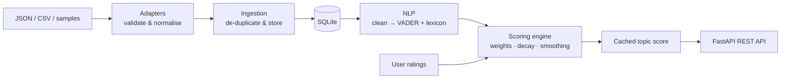

# BluntScore — Multi-Source Sentiment Analysis & Rating Engine

[](https://github.com/BalajiS61/bluntscore/actions/workflows/tests.yml)


BluntScore collects reviews about any topic from multiple sources, classifies each
opinion as **positive, neutral or negative** using NLP, and condenses everything into
one honest, normalized **0–100 score** — served through a validated FastAPI REST API.

```text
GET /api/v1/topics/pixel-9/summary
→ "Positive (68.1/100): 86% positive, 0% neutral, 14% negative across 7 reviews from 3 sources"
```

---

## Features

- **NLP sentiment classification** — VADER (negation, intensifiers, "but"-clauses, emphasis)
  extended with a custom product-review lexicon (*overpriced, laggy, defective, durable…*),
  plus a confidence value for every prediction.
- **Multi-source ingestion** — JSON API, CSV upload and a bundled sample dataset, all through
  one pipeline with field-alias mapping, row-level error reports and de-duplication.
- **Normalized 0–100 scoring** — source reliability weights, recency decay and Bayesian
  smoothing, blended with 1–5 star user ratings, plus a reliability indicator.
- **REST API** — topic search/filter/sort/pagination, score breakdowns, sentiment summaries,
  rating aggregation, source management and score refresh.
- **Production habits** — strict input validation, one consistent error format, request IDs and
  timing headers, 160 automated tests at 97.8% coverage, CI on three Python versions, Docker.

## Architecture



| Layer | Location | Responsibility |
|---|---|---|
| API | `app/api/routes/` | HTTP endpoints, request/response validation |
| Schemas | `app/schemas/` | Pydantic request and response models |
| Services | `app/services/` | Ingestion, sentiment, scoring, topic and rating logic |
| NLP | `app/nlp/` | Text cleaning, VADER analyzer, custom lexicon |
| Scoring | `app/scoring/engine.py` | Pure, framework-free scoring maths |
| Data | `app/models/`, `app/db/` | SQLAlchemy models, constraints, sessions |

## How the score works

1. **Classify** each review: VADER compound score in −1…+1. `≥ 0.05` positive, `≤ −0.05` negative,
   otherwise neutral. Confidence (0.5–1.0) reflects how far the score sits inside its band.
2. **Map** the compound to 0–100: `s = (compound + 1) × 50`.
3. **Weight** each review: `w = source_weight × confidence × 0.5^(age_days / 180)`
   — trusted sources count more, borderline calls count less, old reviews fade.
4. **Smooth** toward neutral with *k* = 5 virtual reviews:
   `review_score = (Σ w·s + k·50) / (Σ w + k)` — one glowing review can't produce 100.
5. **Blend** star ratings (mapped `(stars − 1) × 25`, smoothed the same way):
   `score = 0.7 × review_score + 0.3 × rating_score`.
6. **Report** a verdict (Very negative → Very positive) and `reliability = evidence / (evidence + k)`.

All parameters are configurable through environment variables (see `.env.example`).

## Quick start

```bash
git clone https://github.com/BalajiS61/bluntscore.git
cd bluntscore
python -m venv .venv
# Windows: .venv\Scripts\activate      Linux/macOS: source .venv/bin/activate
pip install -r requirements.txt
cp .env.example .env                   # Windows: copy .env.example .env
python -m scripts.seed_samples         # optional: load the demo dataset
uvicorn app.main:app --reload
```

Open **http://127.0.0.1:8000/docs** for interactive API documentation.

### With Docker

```bash
docker compose up --build
docker compose exec api python -m scripts.seed_samples   # optional demo data
```

The database is kept in the `bluntscore-data` volume between restarts.

## API overview

All endpoints are under `/api/v1`.

| Method | Endpoint | Purpose |
|---|---|---|
| GET | `/topics` | Search (`q`), filter (`category`, `min_score`, `max_score`), sort, paginate |
| POST | `/topics` | Create a topic |
| GET | `/topics/{slug}` | Topic details |
| DELETE | `/topics/{slug}` | Delete a topic and its data |
| GET | `/topics/{slug}/score` | Full score breakdown |
| POST | `/topics/{slug}/score/refresh` | Re-analyze and rescore one topic |
| GET | `/topics/{slug}/summary` | Headline, label distribution, per-source stats, top reviews |
| GET | `/topics/{slug}/reviews` | Reviews, filterable by label/source, sortable |
| POST | `/topics/{slug}/ratings` | Submit or update a 1–5 star rating |
| GET | `/topics/{slug}/ratings` | Rating count, average and distribution |
| DELETE | `/topics/{slug}/ratings/{user_id}` | Remove a rating |
| POST | `/ingest/reviews` | Ingest up to 500 reviews as JSON |
| POST | `/ingest/csv` | Upload a CSV (≤ 2 MB, ≤ 5,000 rows) |
| POST | `/ingest/samples` | Load the bundled demo dataset |
| GET | `/sources` | List sources with review counts |
| PATCH | `/sources/{name}` | Change weight / deactivate (affected topics are rescored) |
| POST | `/scores/refresh` | Rescore every topic |
| POST | `/sentiment/analyze` | Classify one text |
| POST | `/sentiment/analyze/batch` | Classify up to 100 texts |
| GET | `/health` | Service and database status |

Every error uses the same shape:

```json
{ "detail": "Topic 'nothing-here' not found", "code": "not_found" }
```

### Example: rate a topic

```bash
curl -X POST http://127.0.0.1:8000/api/v1/topics/pixel-9/ratings \
  -H "Content-Type: application/json" \
  -d '{"user_id": "balaji", "rating": 5}'
```

### Example: upload a CSV

```bash
curl -X POST http://127.0.0.1:8000/api/v1/ingest/csv \
  -F "file=@samples/example_reviews.csv" \
  -F "topic=Studio Headphones" -F "source=amazon" -F "source_type=ecommerce"
```

The CSV needs a header row with a text column named `text`, `review`, `body`, `comment` or
`content`; optional `author`/`user`, `id`, and `date` columns are recognised too. Invalid rows
are reported with their line number instead of failing the upload.

## Testing

```bash
pytest -v                                                   # 160 tests
pytest --cov --cov-report=term-missing --cov-report=html    # coverage report in htmlcov/
```

Tests run against a fresh in-memory database and cover the NLP engine, scoring maths,
ingestion, every endpoint, validation and error paths. CI runs them on Python 3.11–3.13.

## Project structure

```text
app/
├── api/          routes and shared dependencies
├── core/         settings, logging, error handling
├── data/         bundled sample dataset
├── db/           engine and session management
├── ingestion/    source adapters (JSON, CSV)
├── models/       SQLAlchemy models
├── nlp/          preprocessing, analyzer, custom lexicon
├── schemas/      Pydantic request/response models
├── scoring/      scoring engine
├── services/     business logic
└── main.py       application factory
scripts/          seed_samples.py, demo_scoring.py
samples/          example CSV for uploads
tests/            pytest suite
```

## Design decisions

- **VADER over a transformer model** — fast, needs no GPU or model download, handles negation and
  emphasis well on short review text, and its behaviour is explainable. The analyzer sits behind
  one class, so a transformer could replace it without touching the API.
- **Bayesian smoothing** — prevents small samples from producing extreme scores; the reliability
  field tells clients how much to trust a score.
- **Pure scoring engine** — the maths has no database or framework imports, so it is tested
  directly with exact expected values.
- **Database constraints as a safety net** — score ranges, rating ranges and uniqueness are
  enforced by the database as well as the API.

## Known limitations

- Lexicon-based NLP can misread context, e.g. *"comfortable fit"* where "fit" is a noun.
- Sarcasm and domain-specific slang are not detected.
- SQLite suits a single instance; PostgreSQL would be the next step for concurrent writers.

## Possible extensions

Transformer-based classifier option · aspect-level sentiment (battery, camera, price) ·
scheduled ingestion from live sources · score history and trend charts · authentication and
rate limiting.

## License

MIT — see [LICENSE](LICENSE).
